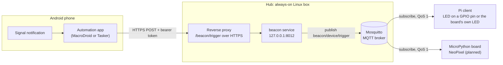
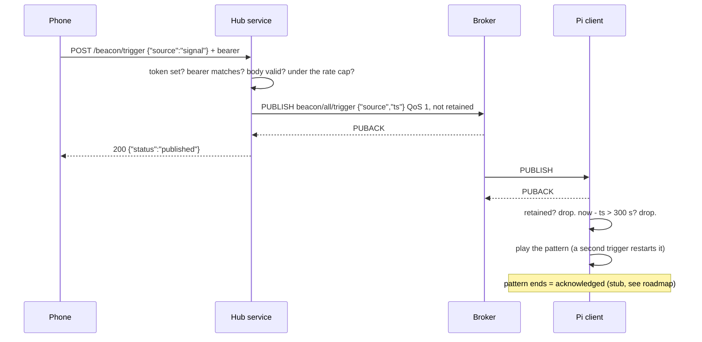
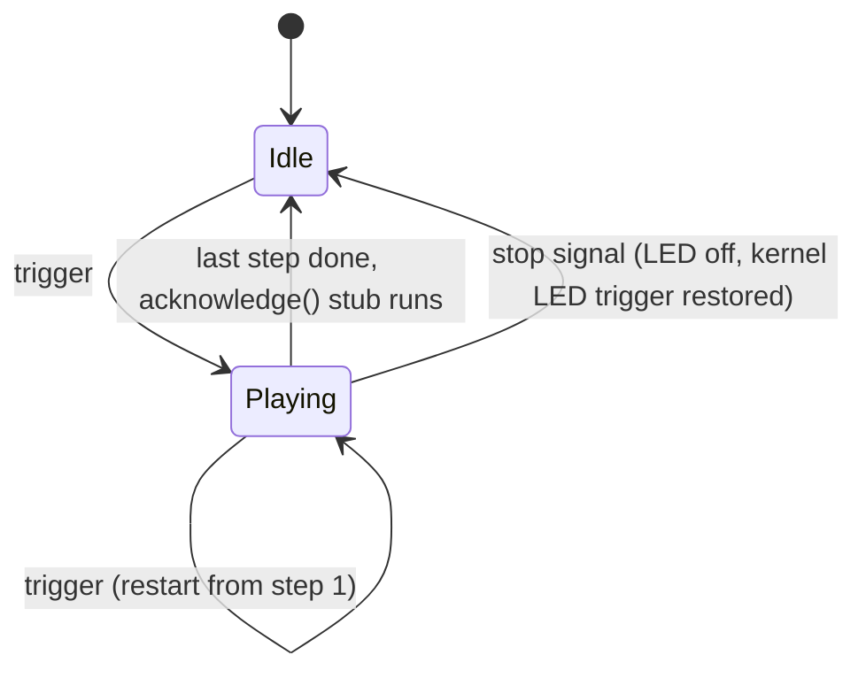
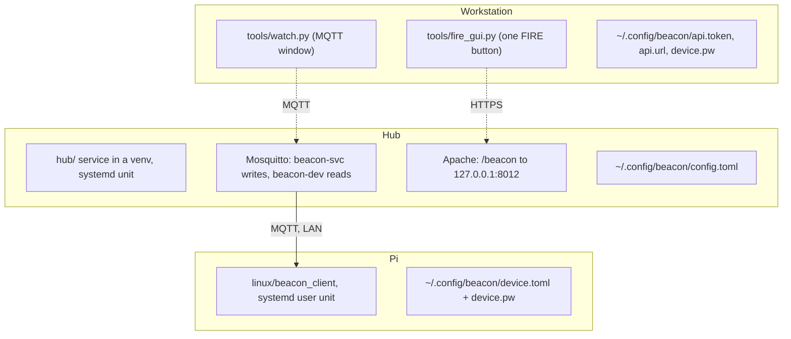
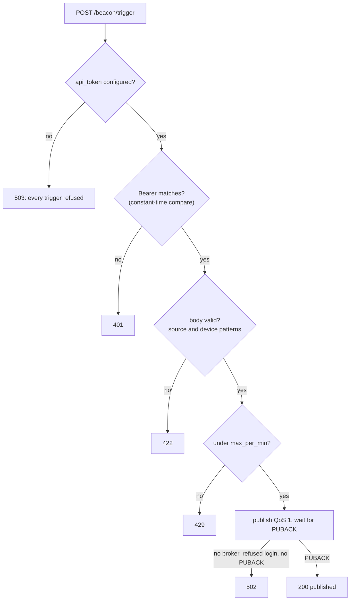

# beacon

A light in the room that flashes when a Signal message lands on your Android phone.

Beacon is for people who cannot hear a phone buzz: a Signal notification on the phone
becomes one authenticated HTTPS request to a small service on an always-on Linux box at
home, which publishes a trigger over MQTT, and every device subscribed to that trigger
plays a flash pattern. Today the device is a Raspberry Pi with an LED; a MicroPython board
with a NeoPixel ring is the planned one. Everything runs on your own LAN; the only thing
that crosses the internet is the phone's request to your own HTTPS endpoint.



## Who it is for, and what it will not do

Commercial alerting hubs take phone input through a vibration sensor under the handset or
a vendor app, cost $90 to $270, and none of them knows about Signal. No published recipe
names Signal either; every "notification to light" recipe filters on the app's package
name, which is exactly what beacon does. So beacon fills a real gap: an arbitrary app
notification, no sensor, no subscription, no cloud.

Be clear about the limits before you build one:

- **It is not a fire alarm** and must not be relied on for anything life-critical. It
  has no battery backup and fails silent when the WiFi or the hub is down (a heartbeat
  indicator is on the roadmap).
- **Light will not wake a sleeper.** Visual alarms do not reliably wake people; a bed
  shaker is the standard answer for that, and beacon does not drive one.
- **Android only.** The phone side is a notification-listener automation; iOS has no
  equivalent API for third-party apps.
- **One flasher per room**, mounted high on a light-colored wall so it is seen by
  reflection. Several unsynchronized flashers in one room are worse than one.
- **Signal only** in the shipped recipe. Any app with notifications works the same way;
  only the package-name filter changes.

## How a message becomes a flash



Three design rules carry the whole thing:

- **Triggers are not retained on the broker.** A device that reboots an hour later must
  not fire for a message you read an hour ago. A missed trigger while a device is offline
  is the lesser harm: the phone still has the message.
- **`ts` is a staleness guard, not a schedule.** The service stamps unix seconds from its
  own clock; a device with time drops anything older than its window (300 s by default)
  and a device with no clock yet fires anyway. With no retain and clean sessions a stale
  trigger should never arrive; this is defence in depth.
- **A second trigger mid-pattern restarts it, nothing queues.** Three messages in one
  second look like one flash, not three.

The pattern engine on the device:



## Safety: flash rate, color, placement

Flashing light has well-studied limits, and beacon enforces the one that matters in code.

- **Rate.** Fire strobes run at 1 to 2 Hz. WCAG 2.3.1 caps web content at 3 flashes per
  second. The Epilepsy Foundation's 2022 review puts the risk band at 3 to 60 Hz with a peak
  at 15 to 20 Hz. Beacon's pattern loader refuses any lit step with `on_ms + off_ms`
  under 500 ms, so **no pattern can flash faster than 2 per second**, whatever the
  config says. Short bright pulses draw attention better than long ones.
- **Color.** Saturated red flashing is a separate risk in the same review and red is the
  conventional emergency color. Use white or amber for messages, keep red for emergencies,
  and never flash the red PWR LED on a Pi alone.
- **Placement.** ADA guidance for visual alarms is a white strobe mounted high; research
  on visual alarm devices finds light walls reflect best. One per room.
- **Restore.** A pattern must leave the light as it found it. The Pi client puts the
  board LED's kernel trigger back when it stops; that is the rule for any lamp or ring.

Sources: [WCAG 2.3.1](https://www.w3.org/WAI/WCAG22/Understanding/three-flashes-or-below-threshold.html),
[Fisher et al. 2022, Epilepsy Foundation review](https://repository.essex.ac.uk/34275/),
[ADAAG visual alarms](https://www.access-board.gov/files/ada/adaag-2002.pdf),
[BRE on visual alarm devices](https://bregroup.com/visual-alarm-devices-their-effectiveness-in-warning-of-fire),
[Jain et al., CHI 2019, smart homes for DHH users](https://soundability.eecs.umich.edu/img/portfolio/Jain_SmartHomeDHH_CHI2019.pdf).

## Quick start

Three roles, three machines (two can be the same box): the **hub** runs the service and
the broker; the **Pi** flashes; the **workstation** is wherever you run the tools. Full
references: [docs/hub.md](docs/hub.md), [docs/pi-client.md](docs/pi-client.md),
[docs/phone.md](docs/phone.md).



**Hub** (Debian or similar, Python 3.11+, Mosquitto 2.x, Apache or any reverse proxy):

```bash
git clone <this repo> ~/beacon && cd ~/beacon/hub && python3 -m venv .venv && .venv/bin/pip install -r requirements.txt
install -d -m700 ~/.config/beacon && install -m600 ../deploy/config.toml.example ~/.config/beacon/config.toml
# fill api_token (openssl rand -hex 32) and the beacon-svc broker password by hand, then the sudo steps in docs/hub.md:
# mosquitto_passwd for beacon-svc and beacon-dev, the ACL, the listener conf, the unit, the ProxyPass
```

**Pi** (Raspberry Pi OS / Debian 13, python3-gpiozero and python3-lgpio from apt):

```bash
install -d -m700 ~/.config/beacon && install -m600 ~/beacon/linux/deploy/device.toml.example ~/.config/beacon/device.toml
# set [mqtt] host and [device] name; put the beacon-dev password in ~/.config/beacon/device.pw (600)
cd ~/beacon/linux && python3 -m beacon_client --test-fire          # the LED blinks, no broker involved
systemctl --user enable --now ~/beacon/linux/deploy/beacon-client.service
sudo loginctl enable-linger $USER                                   # so the unit outlives your login
```

**Phone**: one MacroDroid macro, trigger "Notification Received" filtered to Signal, action
"HTTP Request" POST to `https://<api-host>/beacon/trigger` with header
`Authorization: Bearer <token>` and body `{"source":"signal"}`. Step by step, with the
Tasker alternative and battery-killer fixes: [docs/phone.md](docs/phone.md).

**Prove it** from the workstation, with the token in `~/.config/beacon/api.token`:

```bash
curl -s -w ' %{http_code}\n' -H "Authorization: Bearer $(cat ~/.config/beacon/api.token)" -H 'content-type: application/json' -d '{"source":"signal"}' https://<api-host>/beacon/trigger
```

Expect `{"status":"published","topic":"beacon/all/trigger",...} 200`, the LED runs its
pattern, and `journalctl --user-unit=beacon-client` on the Pi shows
`trigger topic=beacon/all/trigger source=signal age=0s pattern=blink`.

## Design decisions

### The hub fails closed



An empty token means refused, never "no auth". The token is compared in constant time
and never logged. `device` becomes an MQTT topic segment, so it is held to `[a-z0-9-]`
and wildcards are rejected. The rate cap is a real per-process counter: a phone macro
stuck in a loop gets 429s, not a strobe. Two broker logins: the service can only write
`beacon/#`, the shared device login can only read it, so a device can never fire another.

### Two front doors on the planned device

The MicroPython firmware (chunk 2) ships both modes in one build, chosen by config:

- **Hub mode** subscribes to the broker exactly as the Pi client does: the same two
  topics, QoS 1, the `ts` rule, the same `{ steps, repeat }` pattern format and
  acknowledge stub.
- **Standalone mode** serves `POST /trigger` on the device itself with the same bearer
  check and body contract as the hub service, so a phone macro can point at the box
  directly with no hub at all.

Standalone trust model: LAN only, plain HTTP, a per-unit token generated on the box at
first boot and shown once in its web UI. TLS is deliberately absent: a self-signed
certificate on a LAN box is only worth having once a custom phone app can pin it from a
pairing QR, and that app is not v1. That is the reason, not a TODO.

### Acknowledge is a stub

Nobody in the field ships a physical acknowledge button; the models seen are timeout,
tap-to-skip and an MQTT clear. Beacon's current answer is the simplest one: the pattern
ending is the acknowledge. The hook for the real model (sticky until cleared, a button
that publishes an MQTT clear, a timeout failsafe) is `acknowledge()` in
`linux/beacon_client/patterns.py`, and it will need one write-ACL line on the hub.

## Layout

    hub/beacon/            the service: config, log, publish, web, serve (FastAPI + paho)
    deploy/                hub unit, config example, mosquitto conf + ACL, apache snippet
    linux/beacon_client/   Pi client: config, mqtt (stdlib 3.1.1), patterns, led, client
    linux/deploy/          user unit, device.toml.example, udev rule for the onboard LEDs
    tools/                 fire_gui.py, watch.py, app-menu launcher
    tests/                 smoke.py (hub), test_linux_client.py (client, no hardware)
    docs/                  hub.md, pi-client.md, phone.md

Real host names, addresses and paths never enter the repo: the tree uses roles and
placeholders, and the mapping lives in an untracked `notes/site.md`. `notes/` is
gitignored except `notes/prompts/`.

## Roadmap

Built so far, one branch per chunk: hub service (1), phone recipe (4), Pi client (5),
FIRE window (6), onboard LED (7), sanitize and publish (8), this README (9).

Next: **chunk 2**, the MicroPython device with both front doors; **chunk 3**, a flasher
GUI that provisions a board (WiFi, broker login, device name).

## Backlog

- Acknowledge model (timeout vs physical button vs phone clear). Stubbed in chunk 2.
  Revisit the retain decision once it exists.
- Dedicated acknowledge button wiring, once the board is known.
- Quiet hours, brightness schedule, captive-portal provisioning.
- BLE front door (needs a custom Android app; not v1).
- Per-contact patterns (would put sender names on the LAN; send pattern ids only).
- `GET /beacon/health` does not probe the broker; a dead mosquitto only shows as 502 on
  the next trigger.
- Service speaks MQTT 3.1.1, so an ACL-denied publish looks like success (PUBACK). MQTT
  v5 would return "Not authorized" in the PUBACK; worth it if the ACL ever grows.
- Device login `beacon-dev` has no write access; add a status/ack topic when chunk 2 needs it.
- No TLS on the LAN listener: the device password crosses the home WiFi in clear.
- `/var/log/mosquitto/mosquitto.log` is root-only; the smoke cannot read broker logs.
- Pi client: no TLS, same as every device. Lingering for the user unit needs one sudo
  line; a system unit with `User=` is the alternative if lingering is unwanted.
- Pi client: patterns from the config are fixed at start; a config change needs a
  restart. A SIGHUP reload or the Microdot-style web UI is chunk 2 territory.
- Pi client: `--test-fire` and the running unit cannot share the pin; stop the unit first.
- Public-readiness: this README is still a lab notebook. A manual-style rewrite with a
  flow diagram is its own chunk.
- From an accessible-notifier recon (notes, gitignored):
  - Never flash the red PWR LED alone (the 2 Hz cap itself is enforced since 2026-10-22).
  - Acknowledge model, informed by the field: sticky-until-cleared, a physical button
    that publishes an MQTT clear, plus a timeout failsafe. Needs a `write
    beacon/+/status` ACL line on the hub.
  - Heartbeat / offline indicator: people with hearing loss warn about silent failure.
    A device last-will on mosquitto and a visible "beacon down" state.
  - Always restore a lamp or ring to its prior state after a pattern (the Yeelight
    recipe's bug is the warning).
  - Placement and limits: high on a light-colored wall, one flasher per room; light does
    not wake a sleeper, a bed shaker is the standard answer for that.

